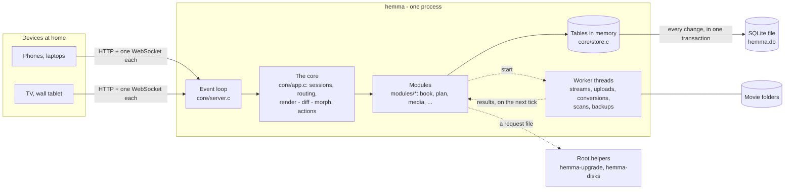

# How Hemma works

Hemma is one C program that serves a household's pages to every phone, laptop, TV and tablet in
the home. This page is the map: how the pieces fit, and where to look. The reasons behind the big
choices are in [docs/decisions](docs/decisions/README.md); the full working contract, down to
every rule, is [CLAUDE.md](CLAUDE.md).

## One process, one thread doing the work

`core/server.c` runs a single-threaded event loop over `poll()`: it reads HTTP requests and
WebSocket messages, and nothing else ever touches the household's data at the same time - so
nothing needs locks. It sleeps until there is work: about once a second while screens are open,
every five seconds when none are. Anything slow - sending a film, receiving an upload, converting a
video, scanning a disk, making a backup - goes to a worker thread, which hands its result back for
the loop to pick up on its next tick. The loop never waits on a disk or the network.

## Pages are drawn on the server

Every open tab is a *screen* with an address. The server draws its whole page as HTML in C
(`H()` in core/html.c escapes by default). After anything changes - an action, someone arriving
home, the minute turning - the core draws each screen again, and when the page's hash differs it
sends `["morph", html]` over that screen's WebSocket. `web/wire.js` in the browser morphs the page
into the new HTML attribute by attribute, so typing, focus and scrolling survive. Buttons and
forms are ordinary links and POST forms underneath: without JavaScript, every page still works.

wire.js also holds the two things only a browser can do: the video player (its controls,
resuming, Live TV's "now", the next episode) and the upload client. It is linted and tested in a
real browser (`tests/browser`); everything else stays in C.

## Modules

Each feature is a folder under `modules/` that registers itself (`MODULE(...)`): book, plan,
board, people, home, media, tv, screens, net, system. A module can draw pages, run actions
(`mod.verb`, each in one database transaction), offer a home card, rows for the TV and the wall,
items for the shared calendar, checks for the System page, and raw HTTP endpoints (video streams,
uploads). Modules don't call each other; the core in `core/` gives them a stable API
(`core/app.h`), so several people can work on different modules at once.

## Data

`core/store.c` keeps every table in memory as typed C records - reading is free - and writes each
change through to SQLite (`hemma.db`, the only third-party library). New fields become new columns
by themselves; numbered migrations handle the rest, and an older Hemma refuses data it can't read
safely. A damaged file is rescued page by page, and nightly backups go to another disk. The movie
library is the folders themselves: a scan builds an index, cached in the same database.

## Video

Videos play straight from disk (HTTP Range requests, `sendfile` on Linux). For files a browser
can't play - DVD rips (MPEG-2, Dolby sound), Dolby Digital Plus, DTS - `modules/av` holds Hemma's own
decoders and encoders in plain C: one MKV in, one MP4 (H.264 + AAC) out, which every browser,
phone and TV plays. The same C code runs on the server and, compiled to WebAssembly, in the
browser that uploads a video: the uploading computer makes the copy, so the Pi does no heavy
lifting. It is fuzzed on every push and for hours every night.

## Accounts and safety

Every page needs a sign-in except the sign-in page itself. Passwords are salted PBKDF2 with a
secret kept outside the database; sessions are stored only as fingerprints; sign-in tries are
throttled before any hashing. The server faces every device on the network, so it checks the
`Host` header, caps connections per device and bounds every buffer. Hemma speaks plain `http://`
and belongs inside a home network ([SECURITY.md](SECURITY.md)). It never changes its own program:
updates and USB disks go through small root helpers in `deploy/` that check everything again.

## Languages

All text people read goes through `T("English")`; Swedish and Spanish sit beside the code in
`*_lang.c` tables. Each request runs in the reader's language - their own choice, else their
browser's - and tests fail when a text lacks a translation.

## Where things are

| Path | What |
|---|---|
| `core/` | The framework: the event loop, HTTP and WebSocket, the store, sign-in, the page shell, dates, the languages |
| `modules/<id>/` | One folder per feature, with its tests (`*_test.c`) and translations (`*_lang.c`) |
| `modules/av/` | The video codecs: a pure C library, no dependencies (it also builds for WebAssembly) |
| `web/` | `wire.js`, the upload converter's Worker, the core stylesheet |
| `tests/` | The test runner and harness (C); `tests/browser` (Playwright, CI only) |
| `tools/` | Developer tools, fuzz targets, the CI and release scripts, the Raspberry Pi image |
| `deploy/` | systemd units, the installer, the root helpers |
| `docs/` | Guides for households, [development](docs/development.md), [decisions](docs/decisions/README.md) |
