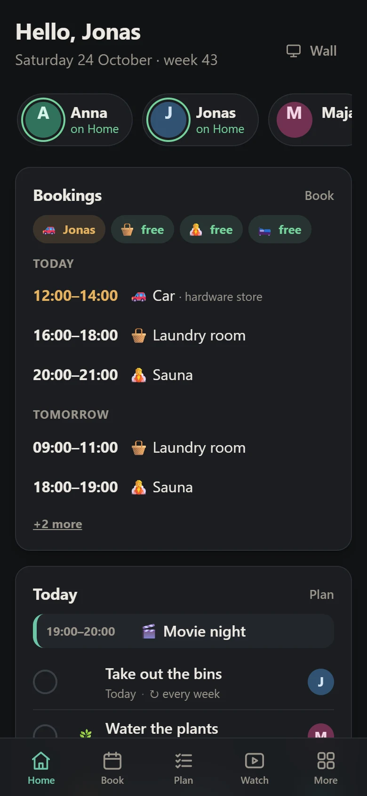
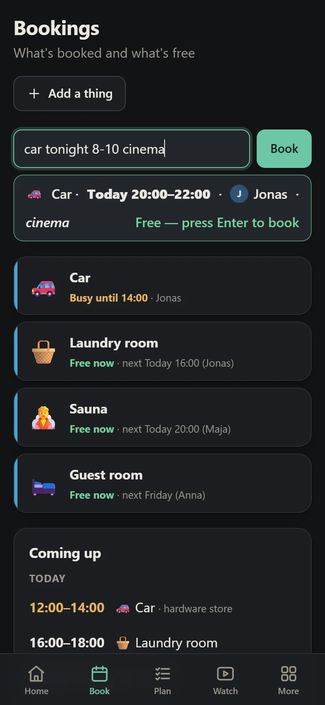
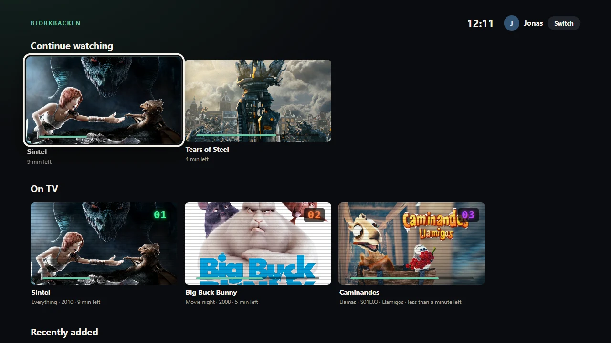
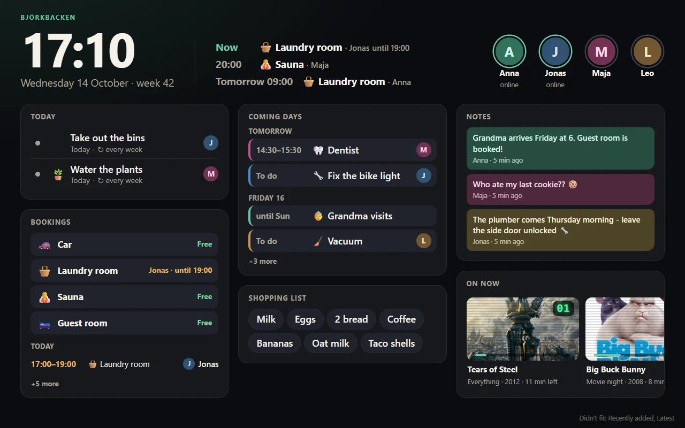
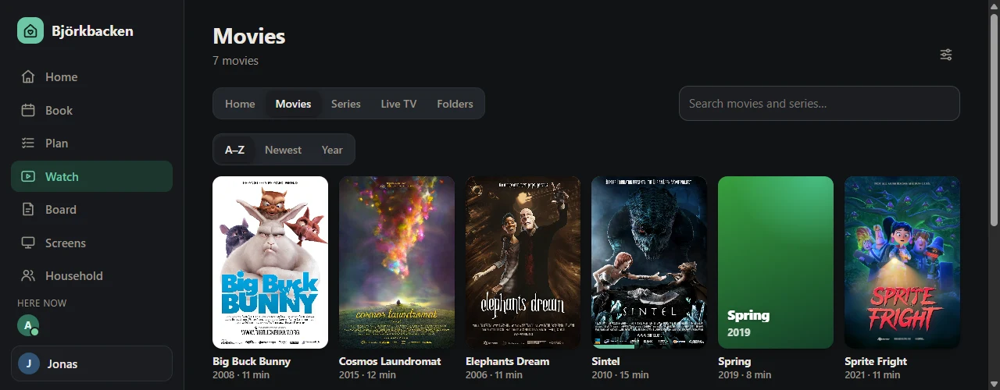

# Hemma 🏡

**Your household's own page, on your own home network.**

Hemma ("at home" in Swedish) is a private web page for everyone who lives in your home.
Book the car or the laundry room, share the chores, the shopping list and the calendar,
leave notes on a shared board, see who's home, and watch your own movies and series on
any phone, TV or laptop in the house. There are even "90s TV channels" that keep
playing your shows around the clock, like real TV.

It runs on one small computer that stays on at home, usually a Raspberry Pi. Everyone
else just opens it in a web browser. There is no app to install and no account to
create anywhere else, and nothing leaves your home network.

Every screen updates live: when someone books the sauna, every open phone, laptop and
the tablet in the hallway shows it straight away.

  
  &nbsp;
  

<em>Home and Book on a phone. Type "car tonight 8-10 cinema" and Hemma shows the
booking (and whether the car is free) before you press Enter.</em>

  

<em>On the TV: big rows for the remote. Whoever picked themselves under
"Who's watching?" gets their own Continue watching; On TV is Live TV.</em>

  

<em>The tablet on the wall: the time, what's on now and next, who's home, and
the household's cards.</em>

The household is made up, and the films are the Blender Foundation's open movies (CC BY):
see [the credits](docs/img/CREDITS.md).

## What's inside

| Section | What it does |
|---|---|
| **Home** | A greeting, who's home, a card from every section and the latest news |
| **Book** | Shared things like the car, laundry, guest room or sauna. It has a week view, warns about clashes and understands quick text like *"car fri 14-17 ikea"* (in English or Swedish) |
| **Plan** | Chores with repeats and people (*"vacuum @sam fri every week"*), a shared shopping list that remembers what you often buy, and a calendar that also shows bookings |
| **Watch** | Your movie and series drive as a little cinema. It sorts series into seasons, has search and subtitles, and remembers where you stopped. It can convert videos a browser can't play (like DVD rips) into a copy that plays everywhere, and moves HEVC films into a file Safari on iPhone, iPad and Mac can play. Admins can upload whole folders from a browser: the uploading computer makes those copies itself, so only the small copy travels and the Pi does no heavy lifting. An upload picks up where it stopped if the connection drops, and skips episodes and films you already have. Admins can remove a film for good, folder and all. **Live TV** ("90s TV") is a tab here: channels that play your shows non-stop on a shared clock, with a TV guide |
| **Board** | The fridge door: notes with pins and colours that disappear when they're out of date |
| **Network** | The devices on your network, who owns which, a good guess at who's home (from phones on the Wi-Fi) and Wake-on-LAN |
| **Screens** | Hemma on the TV: a streaming-app view with big rows you move through with the remote (Continue watching, On TV, Recently added, Series, Movies), arranged by an admin. The TV asks *Who's watching?*: pick yourself (no password) and your progress follows you; on the TV you can only watch |
| **Wall** | An always-on overview for a tablet on the wall (a Screen too): a big clock, what's on now and next, who's home, then cards for today, bookings, the coming days, the shopping list, notes, Live TV and what's new - an admin picks them. Cards with nothing to show stay away. Signed in with a read-only *display* account |
| **Household** | People, sign-ins and roles, and your home's name |
| **System** | For admins: is everything working (in plain words), a getting-started list that ticks itself off, the server's log live, and what to do when something's wrong |

**About posters.** Hemma never looks anything up on the internet, so a new film or series
shows as a coloured card with its title, like *Spring* below. To give it a poster, put
`poster.jpg` in a series folder or `Film Name (Year).jpg` next to a film, or (as an
admin) press **Picture** on its page and pick one from your computer.

  

## Is Hemma for you?

- **Pick Hemma** for one light page for the whole household - bookings, chores, a shared
  board, your own films, a TV view and a wall tablet - on a small computer at home, with no
  cloud and no accounts anywhere else.
- **Pick Jellyfin or Plex** for posters and descriptions fetched for you, apps on every
  TV, or watching away from home. Hemma never looks anything up online and stays on your
  home network.
- **Pick Home Assistant** to control lights, heating and sensors. Hemma doesn't do home
  automation.
- **Pick Nextcloud** for files, photos and contacts.

They don't get in each other's way: Hemma happily runs next to any of them.

## Why Hemma?

- **One small program, nothing else to install.** Hemma is written almost entirely in C,
  close to the hardware ([why C?](docs/development.md#why-c)). It is a single file of about
  2.5 MB with its own built-in database (SQLite). There's no Node, Python, Java or Docker,
  and no web server to set up.
- **Runs happily on a $15 computer.** Because it is so light, a Raspberry Pi (Zero 2, 3, 4
  or 5), an old laptop or a small home server is plenty. Some measurements:
  - On a Raspberry Pi 3B+ in daily use it needs about **2.4 MB of memory**.
  - When idle it wakes up only about **0.2 times a second**.
  - **Eight people streaming at once** (8 Mbit/s each) used about **10% of one core** on a
    simulated Pi 3, and memory peaked at 8.6 MB. On a real Pi 3B+, eight such streams ran
    with zero errors.
  - Uploading a 3.6 GB season of a series ran at full disk speed using 9 MB of memory.
- **Works on old and cheap screens.** The server builds each page and sends only small
  updates. The browser just shows them, so an old smart-TV browser or a cheap phone is
  fine.
- **Private by design.** Hemma only runs inside your home network. It has no cloud, no
  outside accounts, no ads and no tracking. Your data is one database file on your own
  computer.

## What you need

- **A computer that's always on at home.** A Raspberry Pi is ideal (a Pi 4 or 5 if you
  want several movies playing at once), but any Linux computer, a Windows PC or a Mac
  works too.
- **Your home network** (Wi-Fi and/or cable). Phones, tablets, laptops and TVs on the same
  network open Hemma in their browser.
- **For movies:** a folder or USB disk with your video files.
- **About 20 minutes** for the first setup. You'll copy a few commands; the guides explain
  every step.

## Quick start

The usual setup is a Raspberry Pi in a cupboard, plugged into the router:

1. **Prepare the Pi.** Put Raspberry Pi OS Lite on a memory card with Raspberry Pi Imager,
   naming the Pi `hemma` and turning on SSH.
2. **Get Hemma onto it.** Either build it on the Pi (`git clone
   https://github.com/kloparn/Hemma.git hemma`, then `make`) or build it on a PC and copy
   the file over.
3. **Install it.** `sudo sh install-pi.sh ./hemma-pi64` sets Hemma up as a service, and
   `sudo systemctl enable --now hemma` starts it. From then on it starts by itself. The
   installer's last lines show your **setup code**, for example `7KQ4-M2XP`.
4. **Open `http://hemma.local`** in a browser, type the setup code and create the admin
   account. Then add the rest of the household under **Household**.

## First start: the setup code

The very first time Hemma runs, nobody has an account yet, so its first page is a
**Welcome to Hemma** page where you create the admin account: the person who adds
everyone else and looks after the settings.

That page could be opened by anyone on your Wi-Fi: a guest, a housemate, or a misbehaving
gadget that scans the network. To make sure the admin is really *you*, the person who
installed Hemma, the welcome page asks for a **one-time setup code**: eight letters and
digits like `7KQ4-M2XP`. It only appears where you installed Hemma, never on a web page.

**Where to find it**

| You installed Hemma on | Where the code is |
|---|---|
| A Raspberry Pi or Linux with the installer | In the installer's last lines. Missed them? It's also in the settings file: `sudo grep SETUP /etc/hemma/hemma.env`, and in Hemma's log: `sudo journalctl -u hemma \| grep "setup code"` |
| Windows or a Mac | In Hemma's own window (or its log file) right after it starts: `The welcome page asks for this setup code: 7KQ4-M2XP` |
| Any computer, started by hand | In the lines Hemma prints when it starts, next to `No admin yet - open http://... in a browser` |

**How it works**

- Type the code exactly as shown. Upper or lower case and the dash don't matter.
- It works **once**. As soon as the admin account exists, the welcome page and the code
  are gone for good: from then on everyone signs in on the normal sign-in page, and the
  admin adds new people under **Household**.
- A wrong code is refused, and after a handful of wrong tries from the same device Hemma
  makes it wait a while. Guessing it is hopeless: there are about a trillion codes.
- If you restart Hemma before creating the admin, the code stays the same.
- Want to choose it yourself? Put `HEMMA_SETUP_CODE=` with a code of your own in the
  settings file (`hemma --gen-setup-code` makes one).

Right after creating the admin, Hemma shows your **recovery codes**: your way back in if
you ever forget the password. More about all of this in [Accounts](docs/accounts.md).

The [Raspberry Pi guide](docs/raspberry-pi.md) walks through each step. For other
computers:

| Guide | For |
|---|---|
| [Raspberry Pi](docs/raspberry-pi.md) | The recommended home server: choosing a model, setting it up, updates, backups, a USB disk for movies |
| [Linux](docs/linux.md) | Any Linux PC or server (x86-64 or ARM), with or without systemd |
| [Windows](docs/windows.md) | Building and running on Windows 10/11, starting with Windows, firewall, sleep |
| [macOS](docs/macos.md) | Building and running on a Mac, starting at login, firewall, sleep (new) |
| [Your home network](docs/home-network.md) | A fixed address, names like `hemma.local`, TVs, why it's `http://`, safe access from outside |
| [SSH](docs/ssh.md) | "My server has no screen, how do I talk to it?" Connecting, keys, copying files, the handful of commands you'll need |
| [Accounts](docs/accounts.md) | The admin account, adding people, recovery codes, a forgotten password |
| [Troubleshooting](docs/troubleshooting.md) | Is it working? Where the log is, common problems, what to send when asking for help |
| [Development](docs/development.md) | Building from source, tests, project layout, how to contribute |

## How it works

Hemma is one small program. It keeps everything in its own database file and serves the
pages to the browsers in your home. When you open it on a phone, the program draws the
page, and from then on it sends each change to every open screen, so everybody sees the
same thing at the same moment. Videos go straight from the disk to the screen that's
playing them.

There's no cloud and no outside service. Hemma doesn't need the internet at all. It's
made for your home network: as long as you don't open a port for it on your router,
nobody outside your home can reach it. Inside, every page except the sign-in page needs
an account in your household.

## Questions and problems

**After installing: is it working?** The installer (or Hemma's own window) says
`Hemma is running.` and where to open it. Inside Hemma, admins open **System** (under
**More** on a phone): it checks in plain words that everything works, has a
getting-started list that ticks itself off, shows the log live, and offers it as a
download when you ask for help. When something's wrong, see
[docs/troubleshooting.md](docs/troubleshooting.md). Scripts can ask
`http://<address>/healthz`, which answers `ok`.

**The TV (or a phone) says "page not found", "can't connect" or "invalid response".**
Type the full address **with `http://` in front** and use the server's number (IP
address), for example `http://192.168.1.50`. Add `:8080` if you didn't install it on
port 80. Many TVs and some phones try `https://` first, and Hemma doesn't speak it (see
below). Admins find the address to type on the **Screens** page.

**My phone can't find `hemma`.** Plain names like `hemma` usually only work on Windows
PCs. On phones, use **`hemma.local`** or the IP address. Some TVs can't do `.local`
either; use the IP address there and bookmark it. The
[home network guide](docs/home-network.md) shows how to give the server an address
that never changes.

**Why not https?** On purpose. Hemma is for your home network only, where `https://`
would need certificates that your devices don't trust out of the box. The catch: everyone
on your network can read what Hemma sends (on a home Wi-Fi, anyone who knows the Wi-Fi
password can, and any device on it could listen in). So treat everyone you let onto your
Wi-Fi as being "in the house", and give visitors the guest network. If you want to reach
Hemma from outside, use a VPN instead (see the
[home network guide](docs/home-network.md#reaching-hemma-from-outside-the-safe-way)).
Never open a port on your router for it.

**Will Chrome warn me about `http://`?** Not by default. Since version 154, Chrome warns
before loading *public* websites over `http://`, but not addresses on your own network:
`http://192.168.1.50`, `http://hemma` and `http://hemma.local` open as before. Only if
someone switched Chrome to warn about *all* insecure sites does it ask, once, before the
first visit (**Continue to site**). More in the
[home network guide](docs/home-network.md#why-plain-http).

**It works on the server itself but not from other devices.** Check that Hemma isn't
started with `--host 127.0.0.1`, that the computer's firewall lets it in (see the guide
for your system), and that the device is on the same network. A guest Wi-Fi usually
can't see the home network.

**A video won't play.** Open it in **Watch**. An admin can press **Make it play
everywhere** there (or convert many at once under **Watch → Library settings → Play
everywhere**). Hemma then makes a copy that every browser can play.

**I forgot my password.** See [Accounts](docs/accounts.md).

**Where is my data?** It's in one database file, `hemma.db`, inside the data folder
(`/var/lib/hemma` on a Pi set up with the installer). The platform guides explain backups.

## Settings

Most things are set up in Hemma itself. A few server settings live in a small settings
file (`/etc/hemma/hemma.env` on a Pi; on other computers the `hemma.env` the guides pass
with `--env`, or `.env` in the folder Hemma is started from) or come
from command-line flags (`hemma --help`). [.env.example](.env.example) lists them all:

| Setting | What it's for |
|---|---|
| `HEMMA_AUTH_SALT` | A secret mixed into every password. Hemma makes it on its first start and writes it into the settings file; keep a copy safe |
| `HEMMA_PORT`, `HEMMA_HOST` | Where Hemma listens (default: port 8080 on every network address) |
| `HEMMA_DATA` | The folder for the database (default `./data`) |
| `HEMMA_HOSTS` | Extra names Hemma should answer to (see the [home network guide](docs/home-network.md#other-names-hemma_hosts)) |
| `HEMMA_ADMIN_USER`, `HEMMA_ADMIN_PASSWORD`, … | Optional: create the first admin from the settings file instead of the browser (handy for headless installs). See [Accounts](docs/accounts.md) |

## For developers

Hemma is plain C11 with no dependencies beyond the bundled SQLite. It's built with `zig cc`
(Windows, cross-compiling) or any `cc` with `make` (Linux, macOS). Each feature is a
self-contained module under `modules/`, and the pages are drawn on the server. App logic
never runs in the browser: it runs one small, generic script (`web/wire.js`), and uploads
use a worker that runs Hemma's C video converter compiled to WebAssembly. There are over
500 tests, run with `./build.ps1 test` or `make test`. Curious why it's written in C? See
[Why C?](docs/development.md#why-c).

Start with [docs/development.md](docs/development.md): building, tests, the layout and how
to report bugs or send changes. The full working contract (the architecture, how to write
a module, conventions) is in [CLAUDE.md](CLAUDE.md).

## License

Hemma is licensed under the [Apache License 2.0](LICENSE). SQLite, bundled in
`third_party/sqlite`, is in the public domain. The films and posters in the screenshots
are the Blender Foundation's open movies under Creative Commons licenses:
[credits](docs/img/CREDITS.md).
