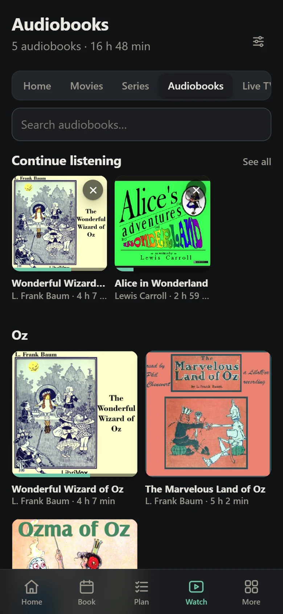
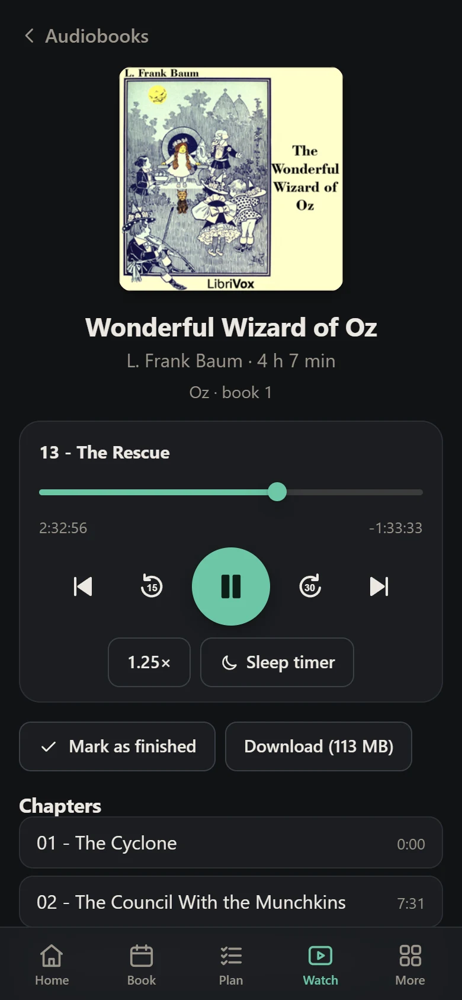
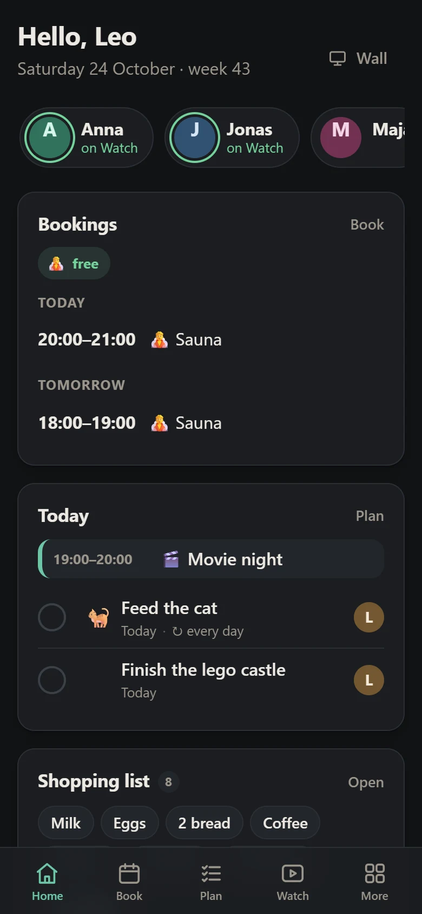
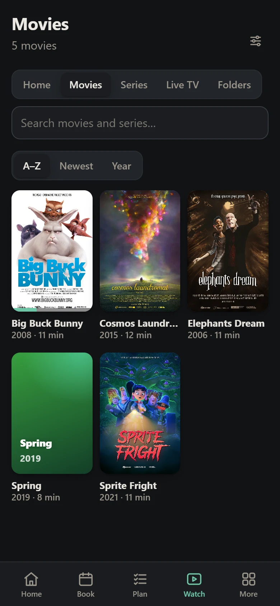
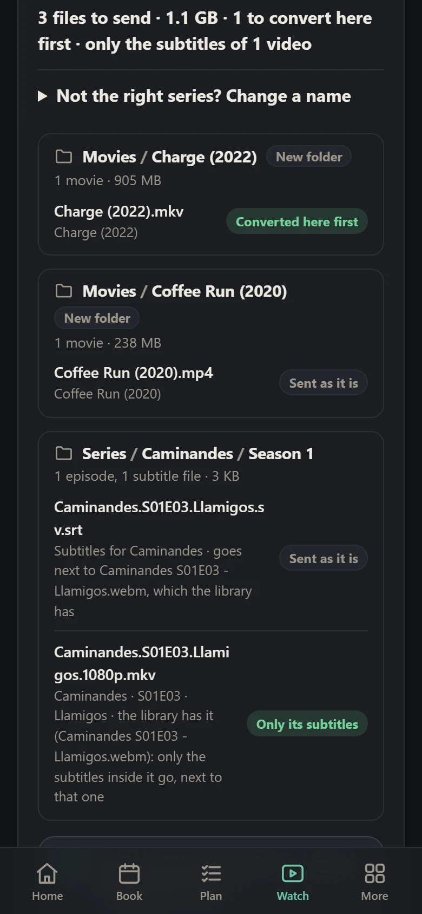
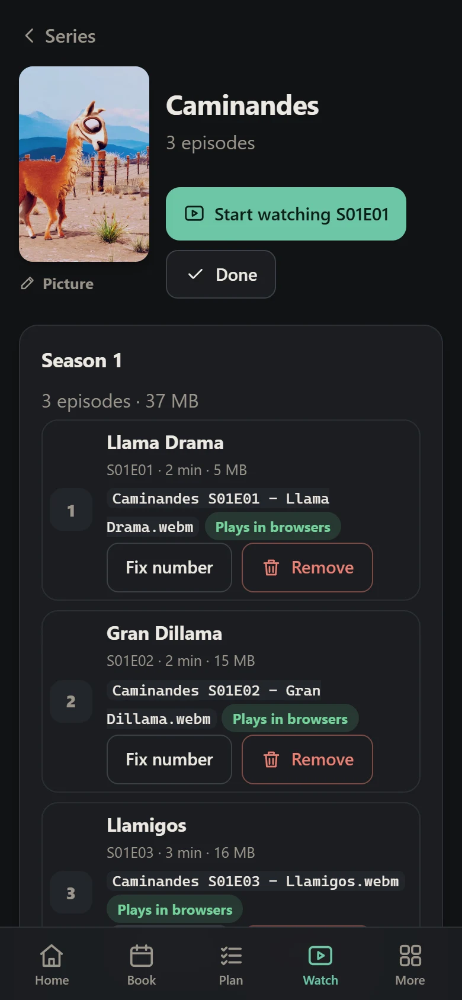

# Hemma 🏡

**One page for your whole household, on your own home network.**

Book the car, share the chores and the shopping list, leave notes on the fridge door, and watch
your own films and series on every screen in the house. Hemma ("at home" in Swedish) runs on one
small computer at home, like a Raspberry Pi. Everyone else just opens it in their browser.

Nothing you have to install (an Android app if you like one), no cloud account, and nothing leaves your home.

<p align="center">
  
</p>
<p align="center"><em>The tablet in the hallway: the time, what's on now and next, who's home, and the household's day.</em></p>

## What you can do

### Plan the week together

Book what you share - the car, the laundry room, the sauna - by typing it the way you'd say it:
*"car tonight 8-10 cinema"*. Chores can take turns, the shopping list remembers what you buy, and
everything lands in one calendar, on your phone's too. When someone books something, every open
screen shows it straight away.

<p align="center">
  
  &nbsp;
  
</p>

### Your own cinema

Your films and series, sorted into seasons and categories, with subtitles, and everyone's own
"continue where you stopped". It works on phones, laptops and the TV, where you pick who's watching
with the remote. There's even Live TV: channels that play your shows around the clock, like TV in
the 90s.

<p align="center">
  
</p>

### Audiobooks too

Your audiobooks get a shelf of their own, and everyone keeps their own place in each book. Listen
chapter by chapter, at your own speed, with a sleep timer, and it keeps playing with the phone locked.

<p align="center">
  
  &nbsp;
  
</p>

### Made for the whole family

Children see what's for them: their own to-dos, the things they may book, and only the films you
haven't marked *Not for children*. Guests get a sign-in that ends on their last day.

<p align="center">
  
  &nbsp;
  
</p>

### Easy to fill with films

Drop a folder of videos on the page. Before anything is sent, Hemma shows where each file will go,
and it converts videos that wouldn't play everywhere, like DVD rips and Dolby or DTS sound
([which videos](docs/video-formats.md)). Fixing a name or tidying up later takes a tap.

<p align="center">
  
  &nbsp;
  
</p>

There's more, like a notice board, who's home, nightly backups, and English, Swedish and Spanish:
**[everything Hemma does](docs/features.md)**.

<sub>The household is made up, the films are the Blender Foundation's open movies (CC BY) and the
audiobooks LibriVox's public-domain recordings: see [the credits](docs/img/CREDITS.md).</sub>

## Why Hemma?

- **Private.** It runs only on your home network: no cloud, no ads, no tracking. Your data is one
  file on your own computer.
- **Nothing to install.** Any browser works: phones, laptops, smart TVs, old ones too.
- **Live on every screen.** Book the sauna, and every open phone and the wall tablet show it at once.
- **Small and cheap to run.** One program of about 5 MB that's happy on a $15 Raspberry Pi, with no
  database server, runtime or Docker to look after ([why it's so light](docs/development.md#why-c)).
- **In your language.** English, Swedish or Spanish, and everyone picks their own.
- **Free and open source** ([Apache 2.0](LICENSE)).

## Is it for you?

| You want | Pick |
|---|---|
| One page for the household - bookings, chores, notes, your films, the TV and a wall tablet - at home, without a cloud | **Hemma** |
| Posters and descriptions fetched for you, apps on every TV, watching away from home | Jellyfin or Plex |
| Lights, heating and sensors | Home Assistant |
| Files, photos and contacts | Nextcloud |

They get along: Hemma runs happily next to any of them.

## Try it in two minutes

Download Hemma for your computer from the [latest release](https://github.com/kloparn/Hemma/releases/latest)
(`hemma-mac-arm64`, `hemma-mac-x64` or `hemma-linux-x64`), unpack it and start it with `--demo`:

```sh
./hemma-mac-arm64 --demo
```

Open `http://localhost:8080`. A made-up household is waiting, and its sign-in is shown on the
page. Nothing is kept.

On a Mac, run `xattr -d com.apple.quarantine hemma-mac-arm64` once first (the programs aren't
signed). On Windows, [build it](docs/windows.md) first.

## Get started

Hemma's usual home is a Raspberry Pi (3, 4, 5 or Zero 2 W) plugged into your router.

1. Download `hemma-<version>-pi.img.xz` from the [latest release](https://github.com/kloparn/Hemma/releases/latest).
2. Write it to a memory card with Raspberry Pi Imager (**Use custom**).
3. Put the card in the Pi, plug it in and wait a few minutes.
4. Open **`http://hemma.local`**, type the setup code from `HEMMA-SETUP.txt` on the card, and
   create your account.

Then add everyone else under **Household**. For films, plug a USB disk into the Pi: Hemma offers it
under **Watch → Library settings**.

Another computer, or a Pi you already use? Pick your guide:

| Guide | For |
|---|---|
| [Raspberry Pi](docs/raspberry-pi.md) | Step by step, updates, backups, a disk for films |
| [Linux](docs/linux.md) | Any Linux PC or server |
| [Windows](docs/windows.md) | Windows 10 and 11 |
| [macOS](docs/macos.md) | A Mac |
| [Your home network](docs/home-network.md) | A fixed address, `hemma.local`, TVs, reaching it from outside |
| [Accounts](docs/accounts.md) | The admin, adding people, children, guests, the TV, a forgotten password |
| [The Android app](docs/android.md) | Hemma in an app of its own: it finds Hemma at home by itself, and saves videos and audiobooks for offline |

## Need help?

- **Is it working?** Admins open **System** in Hemma: it checks everything in plain words. Still
  stuck? See [troubleshooting](docs/troubleshooting.md).
- **The TV or a phone can't open it?** Type the whole address with `http://` in front, and use the
  number, like `http://192.168.1.50`. Hemma uses plain http on purpose, since it's for your home
  network only ([why](docs/home-network.md#why-plain-http)).
- **Away from home?** Use a VPN. Never open a port for Hemma on your router
  ([how](docs/home-network.md#reaching-hemma-from-outside-the-safe-way)).
- **Forgot your password?** Use one of your recovery codes ([how](docs/accounts.md#forgot-your-password)).

## For developers

Hemma is plain C with SQLite built in: no frameworks and no npm. The server draws every page. The
browser runs one small script, plus Hemma's own video converter compiled to WebAssembly.

- [Development](docs/development.md): building, tests, releases, and [why C](docs/development.md#why-c)
- [ARCHITECTURE.md](ARCHITECTURE.md): how the pieces fit together
- [CONTRIBUTING.md](CONTRIBUTING.md): reporting a problem, sending a change
- [Decisions](docs/decisions/README.md): why it's built the way it is
- [CLAUDE.md](CLAUDE.md): every rule in detail (written for AI agents, readable by anyone)

## License

[Apache 2.0](LICENSE). SQLite is in the public domain, and two tables from FFmpeg are under the
LGPL 2.1 or later ([notes](third_party/ffmpeg/README.md)). The films and audiobooks in the
screenshots: [credits](docs/img/CREDITS.md).
